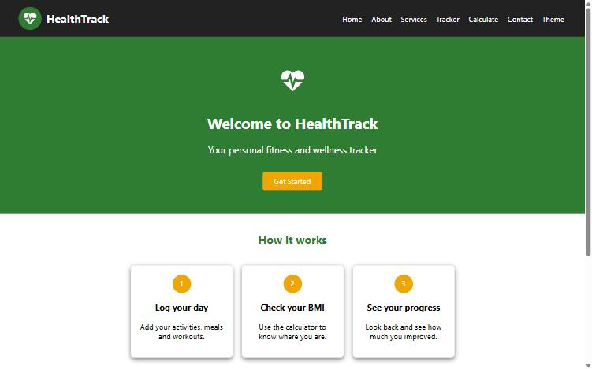
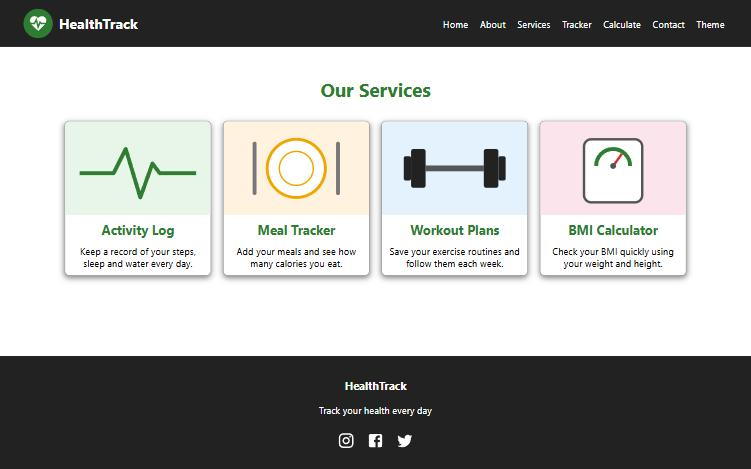
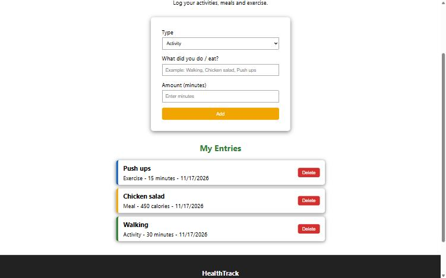
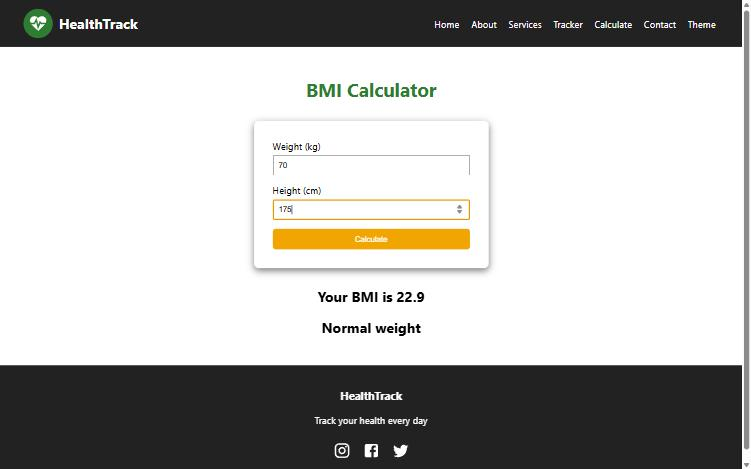
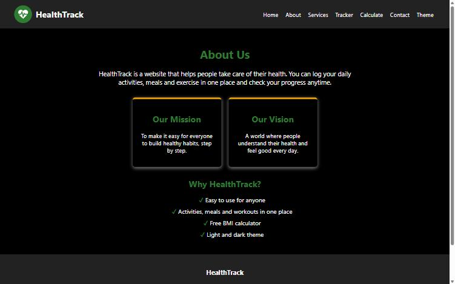

# HealthTrack

HealthTrack is a fitness and wellness website made with ReactJS. It helps users log their daily activities, meals and exercise, and check their BMI.

Live website: https://majedahadi2004-cmyk.github.io/healthtrack

## Features

- **Home** - welcome page with a short "How it works" section
- **About** - what HealthTrack is, our mission and vision
- **Services** - the main features of the website
- **Tracker** - add your activities, meals and exercise. Entries are saved in the browser (localStorage) so they stay after refresh
- **Calculate** - BMI calculator that shows your BMI and your weight category
- **Contact** - contact form
- **Theme** - switch between light and dark theme
- Responsive design, works on desktop and mobile

## Technologies

- ReactJS (Create React App)
- React Router
- Material UI Icons
- CSS
- GitHub Pages

## Setup

You need [Node.js](https://nodejs.org) installed.

1. Clone the project

```
git clone https://github.com/majedahadi2004-cmyk/healthtrack.git
cd healthtrack
```

2. Install the packages

```
npm install
```

3. Run the website

```
npm start
```

Then open http://localhost:3000 in your browser.

4. Deploy to GitHub Pages

```
npm run deploy
```

## Project Structure

```
src/
  Assets/       images and logo
  Components/   Navbar, Footer, ServiceItem
  Pages/        Home, About, Services, Tracker, Calculate, Contact, Theme
  Styles/       one css file for each page and component
  App.js        routes
```

## Screenshots

### Home


### Services


### Tracker


### BMI Calculator


### About (Dark theme)

